# How TabExtend works

Diagrams of the whole program: the parts, how they talk, and the
algorithms that keep it fast and safe. For measurements and the reasoning
behind the video settings, see [video-pipeline.md](video-pipeline.md); for
the threat model, [security.md](security.md).

1. [The big picture](#1-the-big-picture)
2. [Code map](#2-code-map)
3. [A connection, start to finish](#3-a-connection-start-to-finish)
4. [Video: from GNOME to the tablet's screen](#4-video-from-gnome-to-the-tablets-screen)
5. [The frame gate (dropping frames safely)](#5-the-frame-gate)
6. [Choosing the stream size](#6-choosing-the-stream-size)
7. [Choosing the encoder](#7-choosing-the-encoder)
8. [Pairing by QR code](#8-pairing-by-qr-code)
9. [Pairing by code comparison](#9-pairing-by-code-comparison)
10. [Input: touch, pen, mouse, keyboard](#10-input)
11. [Sound](#11-sound)
12. [Finding computers on the network](#12-finding-computers-on-the-network)
13. [The tablet app's screens](#13-the-tablet-apps-screens)
14. [Reconnecting](#14-reconnecting)
15. [The desktop app's threads](#15-the-desktop-apps-threads)

## 1. The big picture

The computer runs the host; the tablet runs the app. GNOME creates a
virtual monitor for the tablet; the host captures it, encodes it as H.264
and sends it over Wi-Fi. Touches and keys travel back the other way.

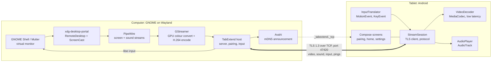

## 2. Code map

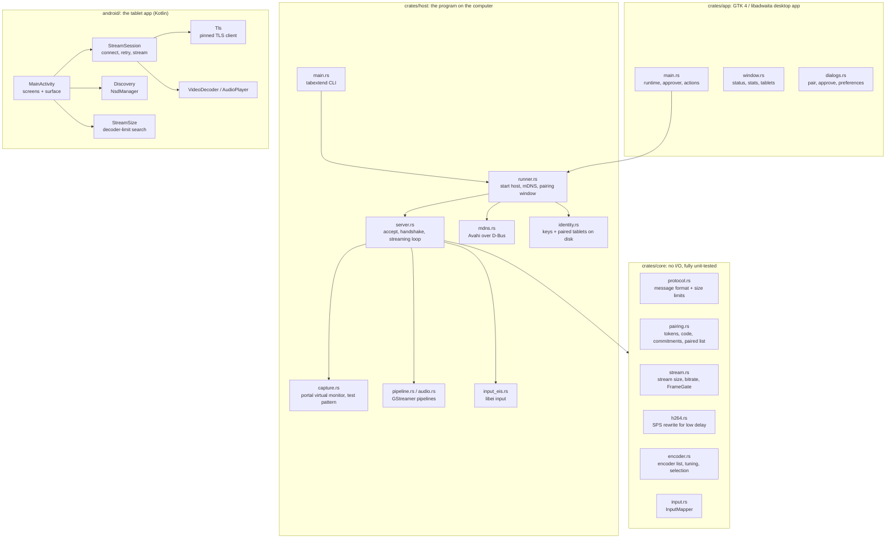

## 3. A connection, start to finish

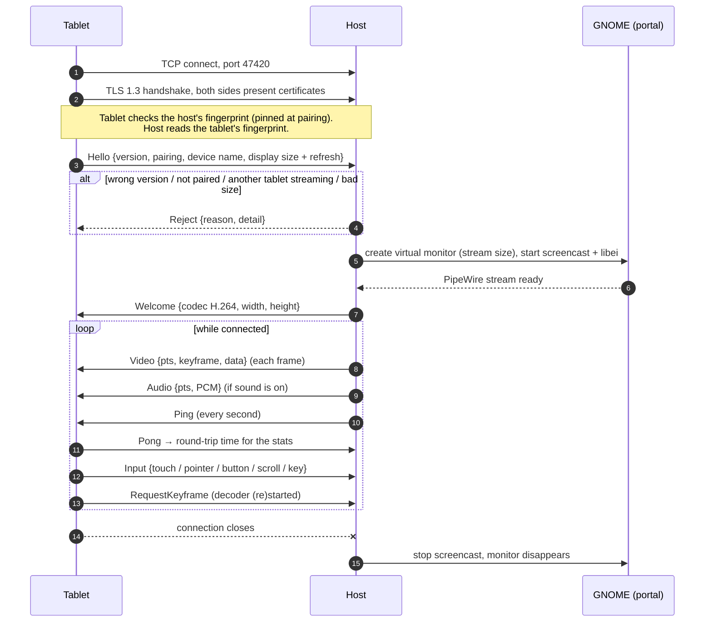

## 4. Video: from GNOME to the tablet's screen

Every stage avoids buffering: a frame that waits is a frame that arrives
late.

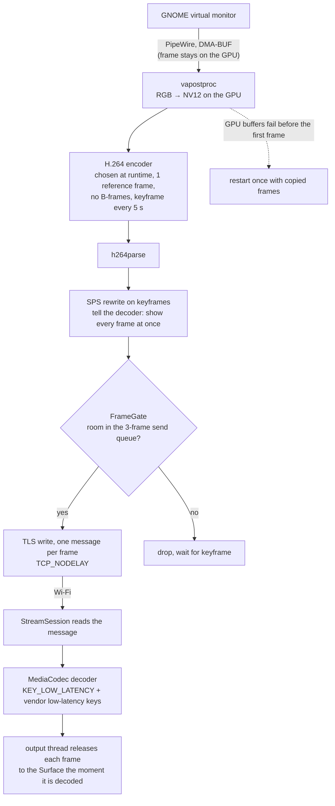

## 5. The frame gate

When Wi-Fi cannot keep up, sending old frames only adds delay, so frames
are dropped. But an H.264 delta frame only makes sense on top of the
frames before it, so after one drop every delta frame is useless until the
next keyframe. The gate (`crates/core/src/stream.rs`) handles this:

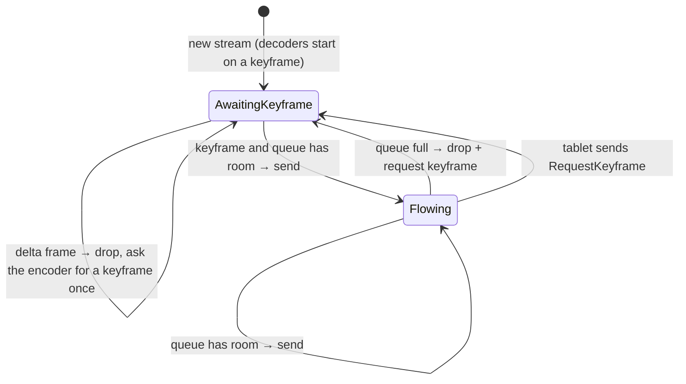

## 6. Choosing the stream size

The tablet asks for the largest picture its decoder can handle at its
refresh rate; the host may shrink it further (Preferences → Resolution).

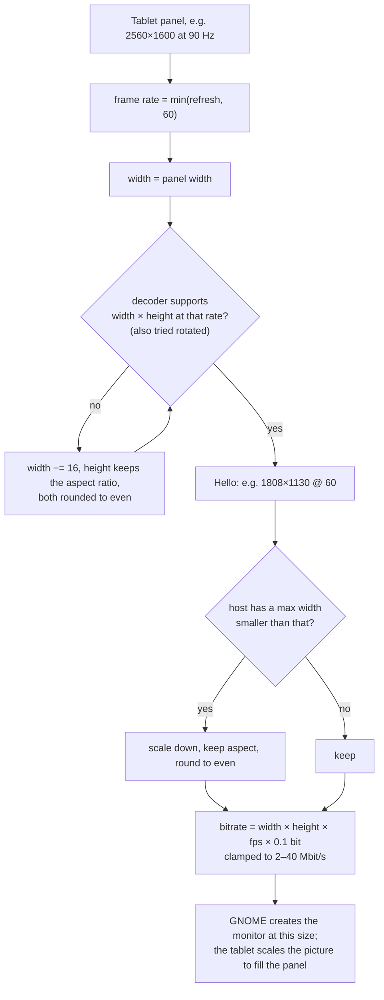

## 7. Choosing the encoder

Nothing is assumed about the hardware: each candidate is tried with a real
test encode, in this order, and the first that works is used. A choice
saved in Preferences goes first.

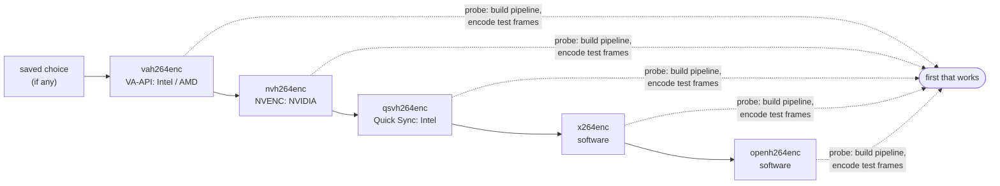

`tabextend doctor` (or System Check in the app) prints the result of every
probe.

## 8. Pairing by QR code

The QR code carries the host's address, its certificate fingerprint, and a
one-time token. Scanning it gives the tablet everything it needs to trust
the host; the token proves to the host that the tablet saw the screen.

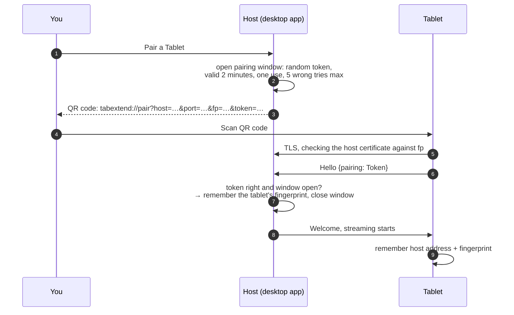

## 9. Pairing by code comparison

Without a camera, the tablet finds the computer on the network and both
screens show a 6-digit code. Neither side knows the other's key yet, so
the code is what proves no one is in between. A commitment stops an
attacker from trying many keys until the codes match: the tablet locks in
its secret before it sees the host's.

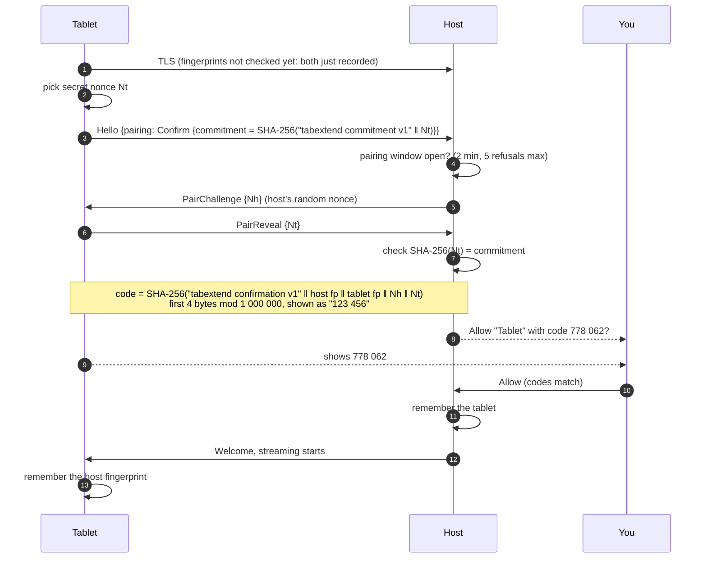

## 10. Input

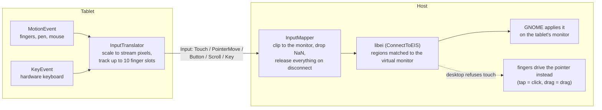

## 11. Sound

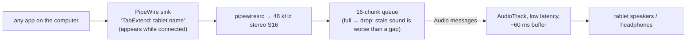

You pick the tablet in the computer's sound settings like any speaker; the
"Play computer sound" switch on the tablet turns playback off.

## 12. Finding computers on the network

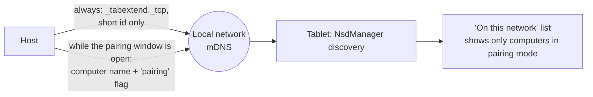

The computer's name is only announced while you are pairing, so the
network does not learn it the rest of the time.

## 13. The tablet app's screens

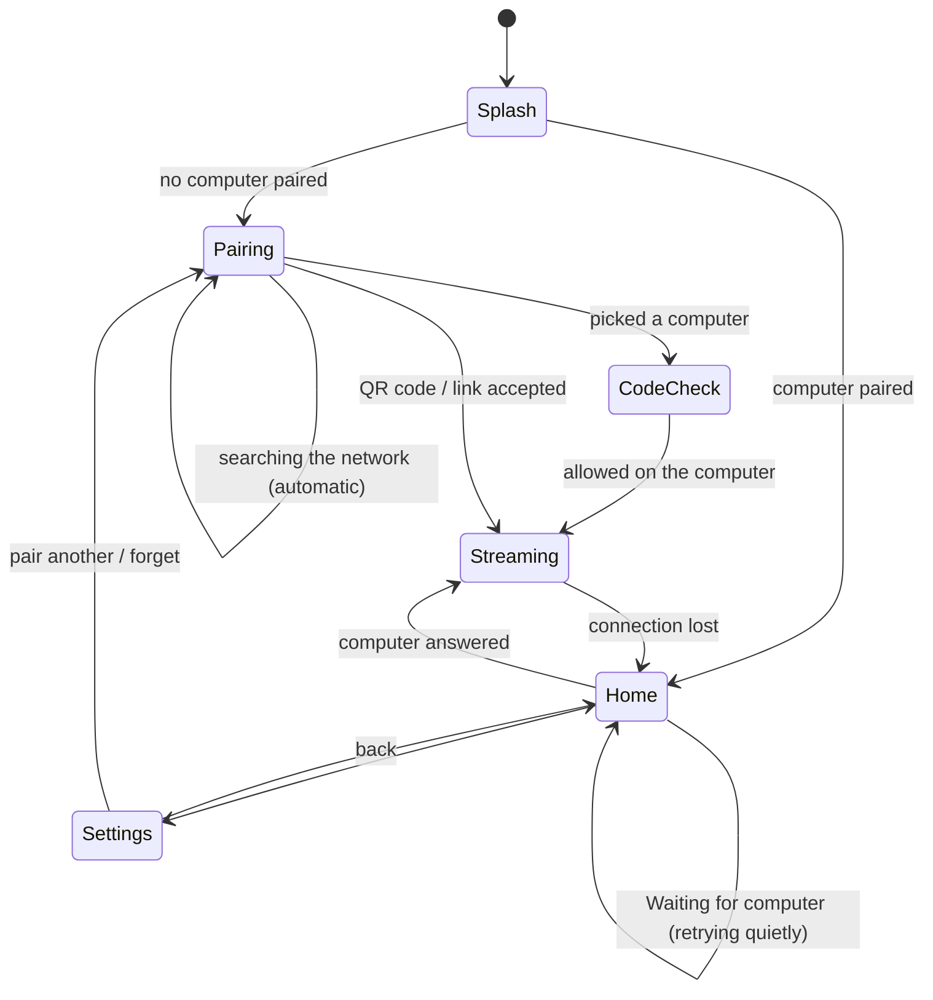

## 14. Reconnecting

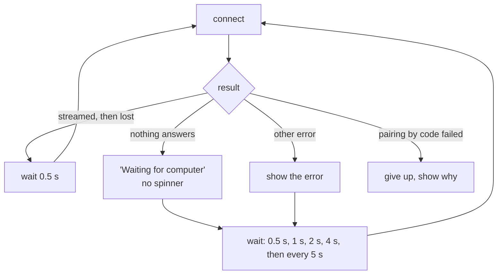

So the tablet connects by itself within about five seconds of TabExtend
starting on the computer.

## 15. The desktop app's threads

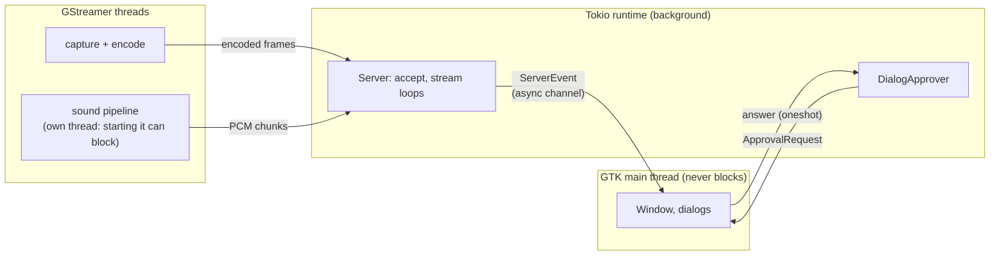
